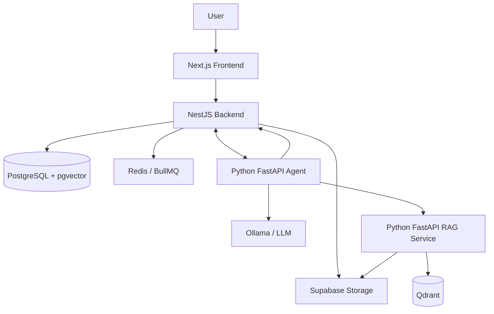
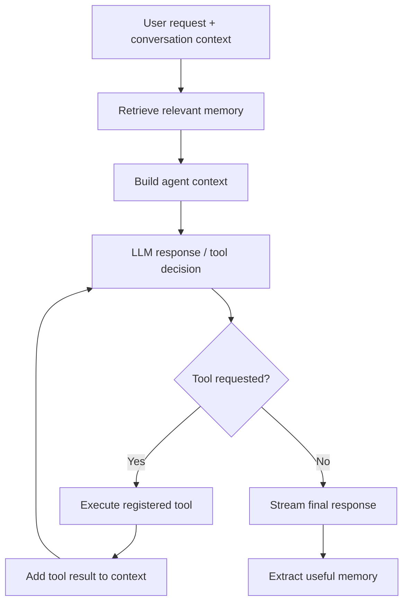

# Priora Mind Cloud

**A personal AI agent platform combining tool orchestration, document retrieval, and persistent memory.**

Priora Mind Cloud is a full-stack, multi-service application for interacting with personal knowledge, documents, and productivity workflows through an AI assistant. Rather than a single LLM wrapper, it separates application concerns, agent execution, retrieval, and persistent data into dedicated services.

> **Engineering focus:** Agentic AI · LLM integration · RAG · Semantic memory · Python services · NestJS backend · Full-stack development

**Status:** Actively developed. This README describes the current architecture and project direction; individual capabilities are evolving.

## Why this project?

An AI assistant becomes substantially more useful when it can do more than generate a response from the latest message. Priora Mind Cloud explores how to combine:

- **Tools** to retrieve information or execute supported application actions
- **Retrieval** to ground responses in uploaded knowledge
- **Memory** to preserve useful context across conversations
- **Application services** to manage documents, conversations, tasks, and user data
- **Streaming** to deliver responses incrementally

## System architecture



### Service responsibilities

| Service | Responsibility |
| --- | --- |
| **Frontend** | Conversations, documents, knowledge organization, and user-facing workflows |
| **NestJS backend** | Authentication, application APIs, persistence, file management, and background jobs |
| **Python agent service** | LLM interaction, tool execution, streaming, and orchestration |
| **Python RAG service** | Document processing, embeddings, and semantic retrieval |
| **PostgreSQL + pgvector** | Application data and semantic memory |
| **Qdrant** | Vector search over document knowledge |
| **Redis / BullMQ** | Background processing |
| **Supabase Storage** | Uploaded document storage |

## AI engineering highlights

### 1. Tool-using AI agent

The agent service coordinates conversations with an LLM and a set of registered tools. Its execution flow supports multi-step tool calls rather than assuming every user request can be answered directly.



The tool/skill system is designed to be extensible: tools perform actions or fetch data, while skills provide task-specific guidance. Tool results are part of the agent's execution context; they are not automatically equivalent to persistent long-term memory.

### 2. Retrieval-Augmented Generation

The retrieval service is a separate Python application using **sentence-transformers** and **Qdrant**. Its role is to retrieve relevant content from uploaded documents, giving the agent access to external knowledge beyond the model's built-in training.

Conceptually, the workflow is:

```text
Document upload
    -> File storage
    -> Background document processing
    -> Text extraction / chunking
    -> Embedding generation
    -> Qdrant indexing
    -> Semantic retrieval at question time
    -> Context supplied to the agent
```

Keeping retrieval separate from agent orchestration makes each service easier to evolve and test independently.

### 3. Long-term semantic memory

The application uses **PostgreSQL with pgvector** for semantic memory. Conversation-derived memories can be extracted, persisted, and retrieved when relevant to a later request.

The memory design distinguishes useful persistent facts and preferences from transient conversation content. This is a separate concern from the document RAG store.

### 4. Structured event memory

The project also explores extracting real-world events from conversations — such as applications, interviews, or other activities — into structured records. The longer-term direction is to relate events through shared entities, semantic similarity, and temporal context.

Event memory is an evolving capability; the README does not claim a fully implemented knowledge graph or automatic episode reconstruction.

### 5. Streaming and application integration

The agent is exposed through **FastAPI**, with streaming response support. A **NestJS** backend coordinates application data and integrates the AI services with the rest of the product.

This separation is intentional: agent reasoning, retrieval, and business data management have different responsibilities and scaling needs.

## Technology stack

| Layer | Technology |
| --- | --- |
| AI orchestration | Python, FastAPI, Ollama |
| RAG and embeddings | Python, sentence-transformers, Qdrant |
| Backend | NestJS, TypeScript, Prisma |
| Frontend | Next.js 16, React, next-intl |
| Relational and vector memory | PostgreSQL, pgvector |
| Object storage | Supabase Storage |
| Background jobs | Redis, BullMQ |
| Deployment | Docker, Docker Compose |
| Testing tools | Jest, Playwright |

## Repository structure

```text
Priora-Mind-Cloud/
├── agent-service/       # Agent runtime, LLM calls, tools, and memory workflows
├── backend/             # Application API, persistence, auth, background jobs
├── frontend/            # Next.js user interface
├── rag-service/         # Document ingestion and semantic retrieval
├── docs/                # Project documentation
├── docker-compose.yml
└── docker-compose-prod.yml
```

## Running locally

### Prerequisites

- Docker and Docker Compose
- Configured PostgreSQL, Qdrant, Redis, and Supabase dependencies
- An accessible Ollama-compatible LLM endpoint
- Valid service-specific environment configuration

Prepare the environment files referenced by `docker-compose.yml`:

```text
backend/.env.docker
agent-service/.env.docker
rag-service/.env.docker
```

Then start the stack from the repository root:

```bash
docker compose up --build
```

The development Compose file maps:

| Service | Local address |
| --- | --- |
| Frontend | http://localhost:3001 |
| Agent service | http://localhost:8000 |
| RAG service | http://localhost:8800 |

The NestJS backend is exposed to other Compose services internally on port `3000`. External dependencies and credentials must be configured separately; this is not a zero-configuration deployment.

## Testing and quality

The repository includes test tooling for the application services. From their respective directories:

```bash
# Backend
npm test
npm run test:e2e

# Frontend
npm run typecheck
npm test
```

These are available commands, **not a claim that the current branch has passed every test**. Evaluation of retrieval relevance, grounded answers, tool selection, and memory quality remains an important area for continued improvement.

## Roadmap

- Improve agent evaluation and execution tracing
- Add stronger retrieval quality and citation checks
- Expand event-memory linking and retrieval
- Improve memory lifecycle management
- Extend task automation and productivity workflows
- Add architecture and product demonstration media

## Engineering principles

- **Separation of concerns:** application backend, agent runtime, and retrieval service are distinct.
- **Grounding over guessing:** document questions should use retrieved knowledge when available.
- **Persistent context with boundaries:** semantic memory is different from chat history and document storage.
- **Extensibility:** tools and skills can be expanded without rebuilding the entire application.
- **Iterative delivery:** features are developed and refined independently.

---

Priora Mind Cloud is a practical exploration of **how to engineer a persistent, tool-using AI application**, from backend infrastructure to retrieval, memory, and user experience.
